# ThinkingAnimations

Twenty-one small SwiftUI animations for showing that something is working. Each one is drawn with `Canvas`, uses one color, and has no assets or dependencies. A rotating indicator cycles through them.

Requires iOS 17 / macOS 14, Swift 5.9.

## Animations

| Name | View | What it does | Preview |
| --- | --- | --- | --- |
| Figure eight | `FigureEight` | Three bodies chase each other along one figure-eight path, each with a fading trail. | 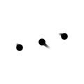 |
| Spark | `Spark` | Twelve rays around a center grow and shrink in a wave while the ring turns. | 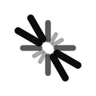 |
| Morph | `Morph` | An outline changes between triangle, square, hexagon and circle while it turns. | 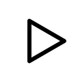 |
| Hex cells | `HexCells` | Seven filled hexagons light up one after another. |  |
| Pendulum wave | `PendulumWave` | Seven dots swing at slightly different speeds, so they line up and drift apart. | 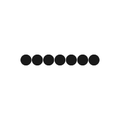 |
| Sunflower | `Sunflower` | 64 dots in a sunflower seed pattern pulse outward in a wave. | 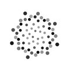 |
| Flip tiles | `FlipTiles` | A 3x3 grid of tiles flips in a diagonal wave. | 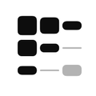 |
| Attractor | `Attractor` | Points move along a Lorenz attractor that slowly rotates. | 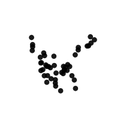 |
| Lissajous | `Lissajous` | A dot traces a looping Lissajous curve with a fading trail. | 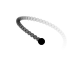 |
| Ripple | `Ripple` | Rings spread from a center dot and fade as they grow. | 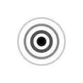 |
| Glider | `Glider` | A Game of Life glider walks across a wrapping 6x6 grid. | 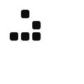 |
| Rose | `Rose` | A rose curve whose petal count drifts while it turns. | 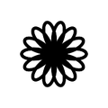 |
| Bars | `Bars` | Five rounded bars rise and fall in a wave. |  |
| Wave | `Wave` | A thick line carries a traveling wave that is pinned at both ends. | 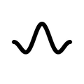 |
| Helix | `Helix` | Two strands of dots twist around each other, larger when near. | 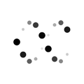 |
| Spirograph | `Spirograph` | A closed spirograph curve turns slowly. | 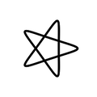 |
| Dot grid | `DotGrid` | A 5x5 grid of dots swells in rings from the center. | 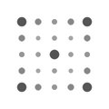 |
| Squares | `Squares` | Five nested squares turn back and forth, each a little behind the last. | 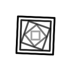 |
| Moire | `Moire` | Two sets of concentric rings slide through each other. | 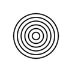 |
| Cube | `Cube` | A wireframe cube turns in perspective and tilts back and forth. | 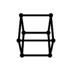 |
| Snake | `Snake` | A lit path with a fading tail runs along a 4x4 grid in a zigzag. | 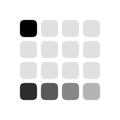 |

## Install

In Xcode: File > Add Package Dependencies, then enter the repository URL. Or in `Package.swift`:

```swift
.package(url: "https://github.com/chiziigam/thinking-animations", from: "0.1.0")
```

## Use

```swift
import ThinkingAnimations

Spark(size: 24, color: .primary)                    // one animation
ThinkingAnimation(.morph, size: 32)                 // pick by name
ThinkingIndicator(since: startDate, size: 24)       // rotates through all of them
```

`ThinkingGallery()` shows all of them in a grid. Open the package in Xcode and use the `Gallery` preview.

## Behavior

- **Reduce Motion:** each animation shows a still pose that fades in and out slowly. Nothing moves.
- **Timing:** `ThinkingTiming` holds the rotation interval (8 s), the cross-fade (1.6 s) and the Reduce Motion pulse.
- **Rotation:** `ThinkingIndicator` shuffles the order from the `since` date and never shows the same animation twice in a row. Removing the view stops it.
- **Accessibility:** the animations are hidden from VoiceOver. Put a label on the surrounding view.

## License

MIT. See [LICENSE](LICENSE).
